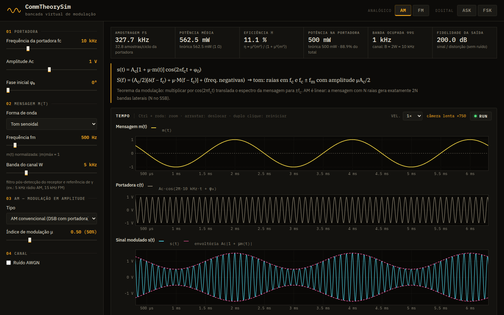
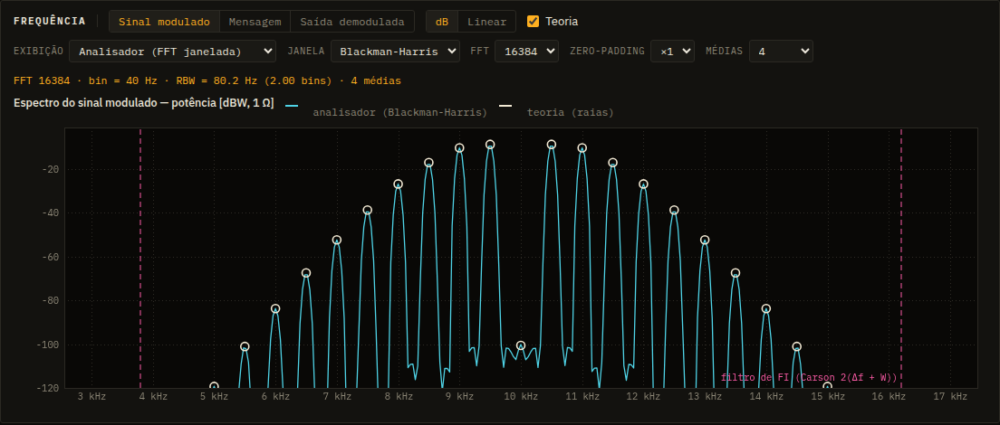
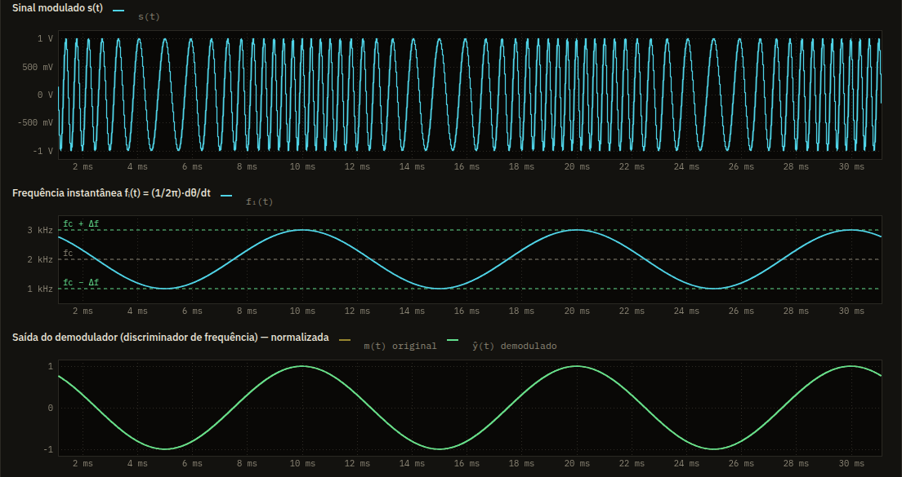
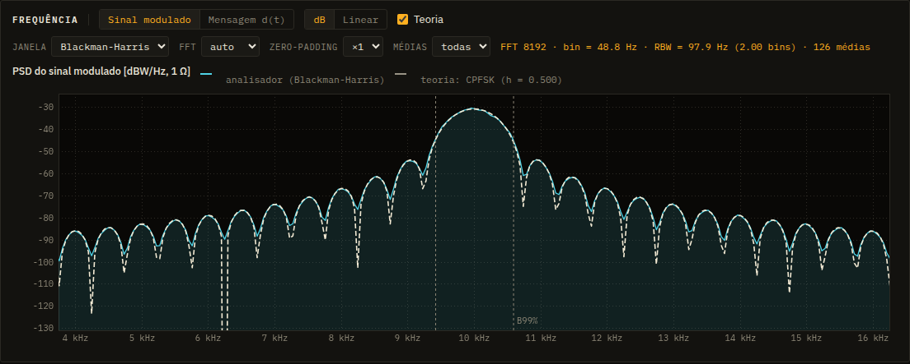

<div align="center">

# CommTheorySim

**Bancada virtual de modulação — AM, FM, ASK e FSK no tempo e na frequência,<br>com a teoria sobreposta ao que é medido.**

[](https://allao255.github.io/CommTheorySim/)


<br>

<a href="https://allao255.github.io/CommTheorySim/"></a>

</div>

<br>

Os sinais são gerados amostra a amostra, o espectro sai de uma FFT de verdade e o receptor
demodula o que chega: nada é desenho de fórmula. Os números medidos (potência, raias, banda,
SNR de saída) são conferidos contra a teoria dos livros dentro da própria página.

## O que dá para explorar

|  |  |
|---|---|
| **AM** | convencional, DSB-SC e SSB · índice μ e sobremodulação · eficiência η · detector de envoltória e coerente com erro de fase |
| **FM / PM** | raias de Bessel Ac·\|Jₙ(β)\| · β = 2,405 (a portadora some) · regra de Carson · discriminador · efeito limiar |
| **ASK / FSK** | NRZ e cosseno levantado · MSK, FSK de Sunde, GMSK · fase contínua × descontínua · PSDs teóricas |
| **Canal** | ruído AWGN pelo nível N₀ · SNR de saída medida × teoria |
| **Espectro** | analisador estilo GNU Radio: janelas, tamanho da FFT, zero-padding, médias e atualização ao vivo |

## Galeria

<table>
  <tr>
    <td width="50%"></td>
    <td width="50%"></td>
  </tr>
  <tr>
    <td><sub><b>FM, β = 2,405.</b> As raias medidas caem sobre os círculos de Bessel, e a da portadora (J₀ = 0) desaparece em 10 kHz.</sub></td>
    <td><sub><b>FM no tempo.</b> Os ciclos de s(t) comprimem e expandem com fᵢ(t); o discriminador devolve a mensagem.</sub></td>
  </tr>
  <tr>
    <td></td>
    <td valign="top">
      <br>
      <sub><b>MSK.</b> PSD medida pelo analisador (Blackman-Harris, 126 médias) sobre a fórmula fechada do CPFSK. Os nulos aparecem preenchidos porque a resolução do analisador é finita, como numa bancada de verdade.</sub>
    </td>
  </tr>
</table>

## Como usar

- **Abas** no topo: AM e FM (analógico), ASK e FSK (digital). Os presets de cada modulação levam
  direto aos casos clássicos.
- **Zoom**: `Ctrl` + roda do mouse sobre um gráfico; arrastar desloca; duplo clique reinicia.
  Os gráficos de tempo andam juntos e o cursor mostra os valores.
- **RUN/STOP e VEL.**: a varredura é sempre em câmera lenta (uma portadora de 10 kHz em tempo
  real seria um borrão). A leitura "câmera lenta ×N" mostra o fator.
- **Ruído**: o slider é o nível N₀ do canal; mais à direita, mais ruído. A SNR resultante aparece
  logo abaixo.
- **Teoria**: as curvas e os círculos claros no espectro são a teoria; liga e desliga em "Teoria".

<details>
<summary><b>A física por trás</b></summary>

<br>

**AM** — `s(t) = Ac[1 + μ·m(t)]·cos(2πfc·t)`. Com um tom, três raias: a portadora (Ac) e
fc ± fm (μAc/2). DSB-SC tira a portadora; SSB usa a transformada de Hilbert e manda uma banda só.

**FM** — `s(t) = Ac·cos(2πfc·t + 2πΔf∫m)`. Com um tom: `Σ Jₙ(β)·cos(2π(fc + n·fm)t)`, β = Δf/fm.
A potência é sempre Ac²/2, só redistribuída entre as raias. PM é FM da derivada da mensagem.

**Receptor** — filtro de FI ideal (2W, W no SSB, Carson no FM) → detector → passa-baixas de banda W.
A SNR de saída medida é comparada com a teoria acima do limiar, com γ = Pₛ/(N₀W):

| Modulação | SNR de saída |
|---|---|
| AM (envoltória) | η·γ |
| DSB-SC, SSB | γ |
| FM | 3(Δf/W)²⟨m²⟩·γ |
| PM | kp²⟨m²⟩·γ |

**Digital** — ASK é o AM com mensagem digital (sinc² + raia da portadora). As PSDs do FSK vêm da
fórmula do CPFSK (Proakis), do FSK de Sunde (h = 1) e de dois OOK para fase descontínua.

**Espectro** — o analisador vê N amostras multiplicadas por uma janela, então cada raia aparece com
a forma da transformada da janela (sinc na retangular), com vazamento e perda entre bins. Uma
senoide de amplitude A no centro de um bin aparece com A²/2 (dBW, 1 Ω), e o ruído com N₀·RBW.
No digital a escala é PSD (dBW/Hz); Hann com todas as médias equivale ao método de Welch.

</details>

## Rodar localmente

Baixe o repositório e dê duplo clique no `index.html`: funciona direto pelo arquivo, sem
instalar nada e sem internet (as fontes IBM Plex caem nas do sistema). Se preferir servir a pasta:

```bash
python3 -m http.server 8765
```

e abra http://localhost:8765.

## Estrutura

```
index.html        página
css/style.css     tema (bancada escura, cores de canal de osciloscópio)
js/dsp.js         FFT, Welch, analisador com janelas, sinal analítico, filtros, Bessel
js/analog.js      AM/FM/PM, demoduladores, raias teóricas e SNR
js/digital.js     ASK/FSK e PSDs teóricas
js/plot.js        plotter em canvas: zoom, cursor sincronizado, decimação min/max
js/main.js        interface, estado, analisador e animação
docs/             capturas de tela deste README
```

<br>

<div align="center">
<sub>Feito por <a href="https://github.com/Allao255">Allao255</a></sub>
</div>
